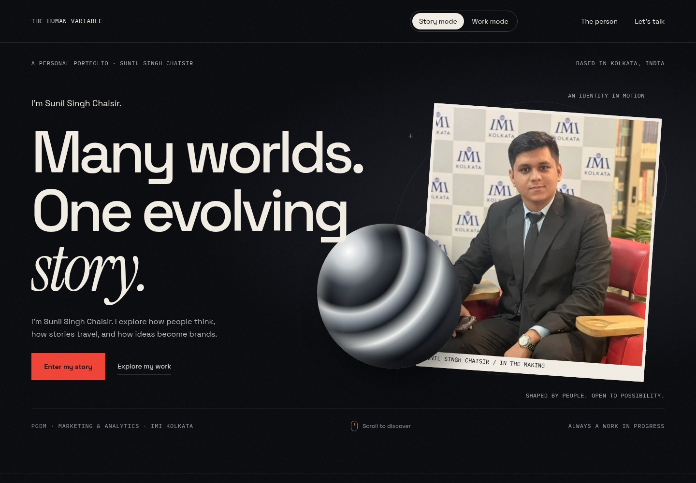

# Sunil Singh Chaisir — Personal Portfolio

**The Human Variable · Many worlds. One evolving story.**

A personal portfolio connecting Sunil’s marketing work, creative interests, and experiences across places and communities. Sunil is an emerging marketing professional pursuing a PGDM at IMI Kolkata, majoring in Marketing and minoring in Analytics.

[Visit the portfolio](https://sunil-human-variable.rarefern512.chatgpt.site)



## Inside the portfolio

- A chapter-based personal story with direct access to work and contact.
- Case studies covering Nirmala Home Kitchen, GAPPU Music / MUSO, and SABERA.
- Authentic personal photography, creative work, and community involvement.
- Responsive layouts, keyboard navigation, and reduced-motion support.
- Scroll-driven storytelling and a decorative chrome object with a static fallback.

Project results retain their context: Nirmala figures describe collaborative brand outcomes, MUSO figures describe student-team work, and SABERA figures describe outcomes Sunil contributed to.

## Built with

- **Next.js App Router, React, and TypeScript** for the application and static pages.
- **SCSS / Sass** for custom layouts and visual styling.
- **GSAP and ScrollTrigger** for narrative animation.
- **Motion** for navigation transitions.
- **Lenis** for smooth scrolling on suitable desktop devices.
- **Three.js and React Three Fiber** for the deferred decorative 3D scene.

Sunil supplied the personal content, photographs, creative direction, and design decisions. AI assistance supported the implementation and technical setup.

## Run locally

Use Node.js 20.9 or newer and npm.

```sh
npm ci
npm run dev
```

Open the local address printed in the terminal.

```sh
# Check TypeScript
npm run typecheck

# Create the production build
npm run build
```

The site uses Next.js static export. Production HTML and assets are generated in `out/`, ready for a static web host.

## Updating content

Project descriptions and attributed outcomes live in `lib/content.ts`. Image dimensions and responsive variants are recorded in `lib/imageAssets.json`. Keep visible copy, case-study pages, metadata, and public profile documents consistent when updating facts or links.

The visual system combines Space Grotesk, Instrument Serif, and IBM Plex Mono with an obsidian, ivory, signal-red, mint, and chrome palette. Preserve the original photographs and factual project context when adapting the site.
